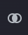

# EmojiMix

Ever wanted to smash two emojis together and get a brand new one? That's all this does. It's a [BetterDiscord](https://betterdiscord.app) plugin that puts a little mix button in your chat bar, a bit like Google's Emoji Kitchen. Pick two emojis, send the result, and you're done.

## Installing

1. Grab [`EmojiMix.plugin.js`](./EmojiMix.plugin.js).
2. Drop it in your BetterDiscord plugins folder (Settings → Plugins → Open Plugins Folder).
3. Switch it on and you're good to go.

## Using it

Click the mix button next to the emoji button, pick one emoji, then pick another. Hold Shift if you want to keep the picker open and mix a few in a row.

This is what the button looks like in your chat bar:

Some pairs don't have official art from Google. Those get blended together locally instead, and they show a tiny dot in the picker so you can tell them apart.

### Typing it inline

You can also just type `:cat+dog:` in a message and it turns into the mix when you hit send. It uses Discord's normal emoji names, so whatever you'd type for `:cat:` works here. Any other Unicode emoji works in the typed syntax too, like `:transgender_flag+cat:`. Those have no official art, so they're blended locally and sent as a server emoji (the link mode can't carry them). If a name isn't an emoji at all, the text is left alone. You can switch this off in the plugin settings. It needs the server emoji or link sending mode, since an image upload can't sit inside a line of text.

## How it sends

You can change this in the plugin settings.

- **Image upload** is the default. Your mix goes out as a small image (32 to 96 px, you choose). Heads up that the phone app blows small images up, so they look bigger there.
- **Server emoji** sends a proper inline emoji that looks right everywhere, phones included. It uploads your mixes into servers you pick and rotates the slots, so the oldest mix gets deleted once a server is full. You need Manage Expressions in those servers. And a reminder, for ya dunces!! Jk. But yes, without Nitro you can only send these inside the server they live in, so **DMs and other servers need Nitro**. Thank discord for this... Any old message that used a rotated-out mix will lose its emoji.
- **Link** just sends the link. It only looks like an emoji for people who also have the plugin.

## Good to know
- If you can't find the setting for server based slots, click the arrow to the right of it in the plugins settings:

- The emoji list is built in, so the plugin doesn't need any other website to be online.
- The mix art is Google's. It gets downloaded once and kept on your computer, and if it can't be reached the plugin makes its own blend instead.
- This isn't affiliated with Google or Discord.

Made with love by Ashley <3 :3

## STILL TRYING TO FIGURE OUT HOW TO BRIDGE THE INCOMPATIBILITY BETWEEN DISCORDS TWEMOJI AND GOOGLES EMOJI SYSTEM!!
The picker will not show every possible combo, inline typed syntax works.

## License

[MIT](./LICENSE)
